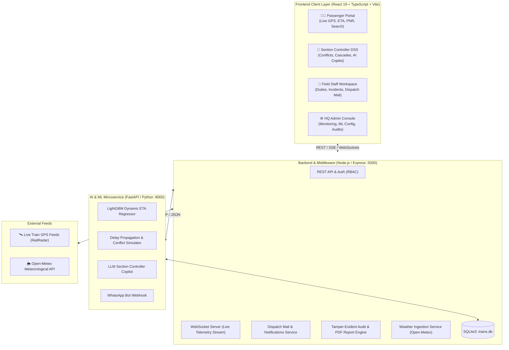

# 🚆 Rail-Sanket / Rail-Drishti

> **Next-Generation Real-Time Dynamic Train ETA Forecasting, Cascading Delay Propagation Engine, Section Controller AI Copilot & Ground Operations Ecosystem**  
> *Developed for Smart India Hackathon (SIH) — Problem Statement #26028*

---

[](https://react.dev/)
[](https://tailwindcss.com/)
[](https://nodejs.org/)
[](https://fastapi.tiangolo.com/)
[](https://lightgbm.readthedocs.io/)
[](https://leafletjs.com/)
[](LICENSE)

---

## 📖 Table of Contents

- [Overview & Problem Statement](#-overview--problem-statement)
- [System Architecture](#-system-architecture)
- [Key Features by Role](#-key-features-by-role)
  - [1. Passenger & Public Portal](#1-passenger--public-portal)
  - [2. Section Controller Decision Support System (DSS)](#2-section-controller-decision-support-system-dss)
  - [3. Railway Employee & Field Staff Workspace](#3-railway-employee--field-staff-workspace)
  - [4. Central HQ Administration Console](#4-central-hq-administration-console)
- [AI & Predictive Intelligence](#-ai--predictive-intelligence)
- [Tech Stack](#-tech-stack)
- [Repository Structure](#-repository-structure)
- [Installation & Getting Started](#-installation--getting-started)
- [Demo Credentials](#-demo-credentials)
- [API Endpoints Reference](#-api-endpoints-reference)
- [Accessibility & Localization](#-accessibility--localization)
- [Team & Acknowledgments](#-team--acknowledgments)

---

## 🎯 Overview & Problem Statement

Indian Railways operates one of the largest and most complex rail networks in the world, running tens of thousands of passenger and freight trains daily across dense, shared corridors. Traditional timetable estimation relies primarily on static schedules and reactive manual logs, leading to:

1. **Inaccurate ETA Forecasts:** Failure to account for line gradients, sectional speed limits, train priority hierarchies, and dynamic track congestion.
2. **Invisible Delay Cascades:** When a primary train suffers a delay, knock-on congestion cascades through downstream block sections and platforms without proactive detection.
3. **Cognitive Overload for Section Controllers:** Rail controllers must manually resolve simultaneous train conflicts under high stress without explainable AI recommendations.
4. **Disconnected Field Teams:** Lack of a synchronized, auditable communication channel between Controllers, Station Masters, Signal Maintainers, and Track Inspectors.

**Rail-Sanket / Rail-Drishti** solves this through a unified digital twin of railway operations: combining machine-learning traversal forecasting, downstream delay propagation simulation, real-time weather risk analytics, an LLM Section Controller AI Copilot, and an integrated field operations dispatch hub.

---

## 🏗️ System Architecture



---

## 🌟 Key Features by Role

### 1. Passenger & Public Portal
- **Real-Time Train Tracking:** Interactive GIS geo-map and dispatcher schematic with live train coordinates, speed, and delay status.
- **Dynamic ETA Tracker:** ML-backed estimated arrival time with confidence scores and explainable delay factors.
- **Between Stations Search:** Station search with autocomplete, distance calculation, schedule breakdowns, and class availability.
- **PNR Status Verification:** Real-time PNR inquiry with berth allotment, coach confirmation probability, and journey itinerary.
- **Station Live Board:** Upcoming arrivals/departures with platform assignments and delay flags.
- **Interactive Assistance:** Embedded WhatsApp chatbot integration for automated schedule lookups and mobile train alerts.

### 2. Section Controller Decision Support System (DSS)
- **Bottleneck & Conflict Detection:** Automated detection of headway violations and platform conflicts across junctions.
- **Delay Cascade Simulator:** Forward-simulation of knock-on delays up to 10 hops downstream based on timetable slack absorption kinetics.
- **AI Controller Copilot:** Context-aware LLM recommendations advising whether to hold, overtake, or reroute trains during operational distress.
- **Weather Hazard Strip:** Live corridor weather metrics (wind gusts, rainfall, visibility) with automatic safety alerts.
- **Staff Roster Allotment:** Real-time allotment and active shift tracking for Station Masters, Loco Pilots, and Maintenance Engineers.

### 3. Railway Employee & Field Staff Workspace
- **Personalized Duty Roster:** Active shift assignments, scheduled sign-ons, and location-based duty status.
- **Operational Dispatch Mail:** Official departmental messaging between Controllers and Ground Staff with read acknowledgments.
- **Incident & Case Reporting:** On-field incident logging with photo uploads, category tagging (Signal, Track, OHE, Mechanical), and priority escalations.
- **Task Management:** Real-time workflow kanban for inspection checklists, maintenance tickets, and clearance approvals.

### 4. Central HQ Administration Console
- **System Health Telemetry:** Real-time monitoring of WebSocket clients, server memory, CPU utilization, and API latency.
- **ML Model Configuration:** Live tuning of ETA inference weights, priority multiplier coefficients, and feature flags.
- **Weather API Management:** Real-time configuration of meteorological polling intervals and safety threshold triggers.
- **Audit Logs & PDF Reports:** Comprehensive, tamper-evident audit trail with one-click export to branded official Indian Railways PDF reports.
- **User Management & RBAC:** Fine-grained role assignment and credential management for passenger, employee, controller, and admin accounts.

---

## 🧠 AI & Predictive Intelligence

### 1. LightGBM Traversal & Dynamic ETA Engine
Trains are modeled using an optimized Gradient Boosted Decision Tree (LightGBM) trained on sectional kinematics:
- **Feature Set:** Current delay, sectional distance, maximum permissible speed (MPS), nominal run time, train priority tier (Rajdhani/Vande Bharat vs. Freight), hour of day, day of week, and station congestion index.
- **Confidence Metric:** Dynamic confidence scoring ($0.45 \le C \le 0.98$) factoring in sectional uncertainty and dwell variability.

### 2. Delay Propagation Modeling
Simulates the domino effect across shared rail infrastructure:
- **Timetable Slack Absorption:** Higher-tier trains recover up to 12% slack per hop; standard passenger trains recover 5%.
- **Platform Headway Safety:** Enforces 5.0-minute safe headway separation at convergent junctions.
- **Conflict Severity Scoring:** Ranks upcoming block contentions by priority divergence and generates proactive regulation directives.

### 3. Section Controller AI Copilot
Powered by LLM reasoning engines (Google Gemini / OpenAI / Anthropic-compatible adapters):
- Translates numerical delay telemetry, track topology, and train priorities into human-readable situation reports.
- Provides actionable, rule-compliant recommendations (e.g., *"Hold Train 12658 at Outer Home; clear Platform 1 for Train 20608 Vande Bharat"*).

---

## 💻 Tech Stack

| Domain | Technology / Library |
| :--- | :--- |
| **Frontend Framework** | React 19, TypeScript, Vite 6 |
| **Styling & UI** | Tailwind CSS v4, Lucide React, Custom Dark/Light Modes |
| **Maps & Spatial** | Leaflet 1.9, React-Leaflet, Protomaps, Leaflet MarkerCluster |
| **Node Backend** | Node.js, Express 5, WebSocket (`ws`), SQLite3, Nodemailer |
| **Python AI Engine** | FastAPI, Uvicorn, Python 3.11, NetworkX, LightGBM, Scipy, NumPy |
| **Data Persistence** | SQLite3 (Relational Schema + WAL mode) |
| **PDF Generation** | Native PDF report generation utility |
| **APIs Integrated** | RailRadar Live Telemetry, Open-Meteo Global Weather |

---

## 📁 Repository Structure

```
Railway-ETA/
├── index.html                      # HTML5 entry template
├── package.json                    # Node.js dependencies & scripts
├── requirements.txt                # Python environment requirements
├── vite.config.ts                  # Vite build configuration
├── tsconfig.app.json               # TypeScript application config
│
├── server/                         # Express & WebSocket Backend
│   ├── server.js                   # Primary Express HTTP & WebSocket server
│   ├── init_db.js                  # Database initialization & migrations
│   ├── audit_service.js            # Audit logging & PDF report engine
│   ├── case_service.js             # Incident and case management
│   ├── mail_service.js             # Internal dispatch messaging system
│   ├── weather_service.js          # Open-Meteo weather integration
│   ├── import_trains.js            # Bulk train master importer
│   └── import_schedules.js         # Timetable schedule importer
│
├── sih26028-rail-eta/              # Python FastAPI & AI/ML Engine
│   ├── requirements.txt            # Python dependencies
│   ├── alembic.ini                 # DB migrations configuration
│   └── src/
│       ├── main.py                 # FastAPI application entry & WebSocket
│       ├── database.py             # SQLAlchemy models & connection pool
│       ├── api/
│       │   ├── routes.py           # Core ETA, route & corridor endpoints
│       │   ├── gps_tracker.py      # Real-time GPS ingestion & tracking
│       │   └── whatsapp_bot.py     # WhatsApp conversational webhook
│       ├── ml/
│       │   ├── predictor.py        # LightGBM traversal & ETA models
│       │   ├── propagation.py      # Downstream delay propagation engine
│       │   └── features.py         # Kinematic feature engineering
│       ├── llm/
│       │   ├── copilot.py          # Section Controller AI Copilot service
│       │   └── provider.py         # LLM provider interface
│       └── seeds/
│           └── dev_seed.py         # Synthetic seed & corridor topologies
│
└── src/                            # React 19 TypeScript Frontend
    ├── main.tsx                    # React application bootstrap
    ├── App.tsx                     # Top-level routing & RBAC protection
    ├── index.css                   # Global styles & high-contrast themes
    ├── context/                    # React Context (Theme, Telemetry)
    ├── layouts/                    # Public, Controller & Admin layouts
    ├── components/                 # Reusable UI widgets & map components
    │   ├── ImageCropModal.tsx      # Avatar & document cropper
    │   ├── LanguageAndA11yControls # Multi-language & accessibility drawer
    │   ├── ThemeToggle.tsx         # Dark / Light theme switcher
    │   ├── TrainETATracker.tsx     # Live ETA prediction visualizer
    │   ├── WeatherWarningIndicator # Real-time meteorological alerts
    │   ├── controller/             # Controller DSS panels (Conflicts, Cascades)
    │   └── employee/               # Employee dashboard widgets & sidebar
    ├── pages/                      # Page views for all 4 personas
    │   ├── public/                 # LiveMap, LiveTrainStatus, PNRStatus, BetweenStations
    │   ├── controller/             # Controller dashboard, dispatches, train details
    │   ├── employee/               # Duty, alerts, incidents, tasks, report, mail
    │   └── admin/                  # Dashboard, users, models, weather, audit logs
    ├── services/                   # Frontend API & WebSocket consumer services
    └── data/                       # Pan-India stations, employee rosters & mock data
```

---

## 🚀 Installation & Getting Started

### Prerequisites
- **Node.js** $\ge$ 18.0.0
- **npm** $\ge$ 9.0.0
- **Python** $\ge$ 3.10
- **Git**

---

### Step 1: Clone the Repository
```bash
git clone https://github.com/pewdiepie4259/SIH-26028-Rail-Sanket.git
cd SIH-26028-Rail-Sanket
```

### Step 2: Set Up the Frontend & Node.js Backend
```bash
# Install Node dependencies
npm install

# Initialize the SQLite database and seed initial tables
npm run db:init
```

### Step 3: Set Up the Python AI Microservice
```bash
# Navigate to the Python service directory
cd sih26028-rail-eta

# Create and activate a virtual environment
python -m venv venv
# On Windows:
.\venv\Scripts\activate
# On Linux/macOS:
# source venv/bin/activate

# Install Python dependencies
pip install -r requirements.txt

# Run the development seed to initialize corridor graphs and train schedules
python -m src.seeds.dev_seed

# Return to root directory
cd ..
```

---

### Step 4: Running the Application

You can run the full ecosystem concurrently using three terminal windows:

#### Terminal 1 — Node.js Backend Server (Port 5000)
```bash
npm run server
```

#### Terminal 2 — Python AI & ML Engine (Port 8000)
```bash
cd sih26028-rail-eta
uvicorn src.main:app --host 0.0.0.0 --port 8000 --reload
```

#### Terminal 3 — Vite Frontend Dev Server (Port 5173)
```bash
npm run dev
```

Open your browser and navigate to **`http://localhost:5173`**.

---

## 🔐 Demo Credentials

The platform provides pre-configured role-based authentication with automated fallback provisioning for quick evaluation:

| Role | Email / ID | Default Password | Initial View |
| :--- | :--- | :--- | :--- |
| **Passenger** | *No login required* | — | `/` (Passenger Home) |
| **Section Controller** | `shriya.m@raildrishti.gov.in` | `controller123` | `/controller/dashboard` |
| **Railway Employee** | `ramesh.sharma@railnet.gov.in` | `employee123` | `/employee/dashboard` |
| **HQ Administrator** | `admin@raildrishti.gov.in` | `admin123` | `/admin/dashboard` |

> *Note: For testing, visiting `/controller`, `/employee`, or `/admin` directly automatically provisions authorized evaluation sessions.*

---

## 📡 API Endpoints Reference

### Node.js Backend (`http://localhost:5000`)
- `GET /api/trains/search?query=:q` — Search trains by name or number
- `GET /api/trains/:trainNumber/live` — Live GPS coordinates, delay, and station telemetry
- `GET /api/stations/search?q=:q` — Pan-India station lookup
- `GET /api/stations/between?from=:src&to=:dest` — Trains running between stations
- `GET /api/pnr/:pnrNumber` — PNR status and booking confirmation
- `GET /api/dispatches/inbox` — Employee / controller dispatch messages
- `POST /api/cases` — Submit ground incident report
- `GET /api/weather/live` — Real-time weather and safety alerts
- `GET /api/audit/logs` — Tamper-evident operational audit trail
- `GET /api/audit/report/pdf` — Stream generated official PDF audit report
- `WS /ws/telemetry` — Live WebSocket broadcast of network telemetry

### Python AI Core (`http://localhost:8000`)
- `POST /api/predict/eta` — LightGBM traversal duration and arrival timestamp prediction
- `POST /api/propagation/simulate` — Downstream knock-on delay propagation modeling
- `POST /api/copilot/explain` — Section Controller AI Copilot reasoning and recommendations
- `POST /api/whatsapp/webhook` — WhatsApp conversational bot integration
- `WS /ws/telemetry` — Telemetry stream from the corridor graph simulator

---

## ♿ Accessibility & Localization

Rail-Sanket is designed to be universally accessible to all citizens and railway personnel:
- **Multi-Lingual Localization:** Full interface translation for English, हिन्दी (Hindi), ಕನ್ನಡ (Kannada), தமிழ் (Tamil), తెలుగు (Telugu), বাংলা (Bengali), and मराठी (Marathi).
- **Universal Accessibility Widget:**
  - Dynamic font-scaling (A- / A / A+)
  - High-Contrast Mode (WCAG 2.1 AAA Compliant)
  - Screen Reader Announcements & Keyboard Navigation shortcuts
  - Dark / Light Mode with seamless theme persistence

---

## 👥 Team & Acknowledgments

- **Team Name:** Rail-Drishti / Rail-Sanket
- **Event:** Smart India Hackathon (SIH)
- **Problem Statement ID:** #26028
- **Domain:** Ministry of Railways / Transportation & Logistics

---

<p align="center">
  <b>Rail-Sanket / Rail-Drishti</b> — <i>Pioneering Precision, Safety & Punctuality for Indian Railways</i> 🇮🇳
</p>
